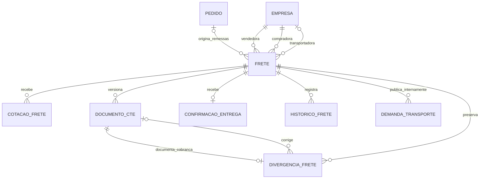

# Histórico de desenvolvimento — ZenWaste

> **Estado atual após a integração full-stack de 08/11/2026:** a página de auditoria passou a utilizar os 17 contratos HTTP de fretes, com consultas, comandos e persistência reais. A inspeção atual encontrou as migrations `0001` e `0002` de fretes já aplicadas no principal; esta tarefa não aplicou migrations nesse banco. A regressão backend atual aprovou 149 testes, incluindo CORS para `Idempotency-Key`. Os fluxos de navegador, mudanças de arquitetura, arquivos e resultados finais estão em [RELATORIO_FINAL_FRETES.md](RELATORIO_FINAL_FRETES.md). Os registros abaixo descrevem etapas anteriores e devem ser interpretados conforme sua data e escopo; afirmações de ausência de API, tela demonstrativa ou migration pendente não representam mais o estado atual de fretes.

> **Atualização posterior à consolidação abaixo, em 08/11/2026:** a finalização do backend de fretes implementou serviços transacionais, serializers de saída e as 17 rotas, com 148 testes backend aprovados em PostgreSQL descartável (36 originais de modelagem, 39 novos de fretes e 73 de regressão). O diagnóstico somente de leitura encontrou `fretes.0001_initial` aplicada no principal e a `0002` pendente. Nenhuma migration foi aplicada ao principal nesta finalização. O corpo abaixo permanece como registro da etapa anterior; o estado atual, os contratos e os limites estão no [README de fretes](BackEnd/fretes/README.md).

**Data de referência:** 08/11/2026, fuso America/Sao_Paulo.

**Escopo:** contexto desta conversa, código local inspecionado e registros históricos identificados nas referências.
**Finalidade:** permitir a continuidade do desenvolvimento sem confundir código existente, modelagem, demonstração e integração concluída.

## 1. Como interpretar este histórico

Este documento consolida evidências disponíveis; não reconstrói decisões ou resultados que não estejam na conversa, no código ou nos relatórios consultados. A existência de uma classe, uma migration ou um botão não comprova sua disponibilidade no banco ou no servidor em execução.

| Classificação | Significado neste documento |
| --- | --- |
| **Implementado** | Há código executável para a responsabilidade descrita. Quando envolve API, a rota está registrada. Isso não certifica implantação ou integração externa em produção. |
| **Modelado / preparado** | Há models, contratos, políticas ou migrations, mas falta completar o fluxo de aplicação, a persistência ou a exposição por API. |
| **Demonstrativo** | A funcionalidade opera com dados locais ou integração simulada, sem comprovar o efeito externo apresentado. |
| **Parcial** | Apenas uma parte do fluxo está disponível; o limite é descrito junto à funcionalidade. |
| **Pendente** | Não foi encontrada implementação completa no escopo consultado. |

Na preparação deste arquivo foram feitas leituras e inspeções do Git. Não foram executados testes de aplicação, chamadas de API, conexões ao PostgreSQL, migrations ou alterações de código. Resultados de execução citados a seguir pertencem às etapas anteriores explicitamente identificadas.

Não foram reproduzidos valores de credenciais, conteúdo de `.env`, dados de bancos, assinaturas ou exemplos privados do README local de pedidos.

## 2. Linha do tempo disponível

| Etapa | Evidência e resultado | Limite |
| --- | --- | --- |
| Reestruturação anterior de backend e dados | Registros de modelagem descrevem catálogos, papéis de empresa, imagens de anúncio, reservas vinculadas a pedidos, nomenclatura em português e serviços transacionais. | Não há aqui histórico integral de todas as conversas que originaram essas alterações. |
| Aplicação anterior da modelagem principal | O documento consolidado registra backup e aplicação autorizada de **15 migrations**, com conferência de 13 tabelas de negócio e preservação de identificadores legados no PostgreSQL. | Essa aplicação é anterior à retomada atual de fretes. Não significa que as migrations de fretes foram aplicadas ao banco principal. |
| Refatoração anterior do frontend | Transporte HTTP, services por domínio, tipos, hooks, contextos, estados de consulta e extração da auditoria demonstrativa. | A organização da tela não tornou logística ou CT-e integrações reais. |
| Plano de integração de fretes, 06/11 | Define sete entidades, remessas parciais/avulsas, participantes, tolerância e rotas planejadas. | O próprio plano advertia que não comprovava endpoints ou migrations disponíveis. Duas perguntas ainda estavam pendentes naquele registro. |
| Auditorias e lotes B1/B2, 08/11 | Limpeza limitada de dependências/componentes sem uso e organização das evidências de navegador. | Os relatórios de cada etapa devem ser lidos com sua data e seu escopo. |
| Otimização B4, 08/11 | Redução de consultas redundantes e preservação de contratos e transações por Pedido. | A tentativa de transação global foi descartada. Não tratar o relatório da tentativa descartada como implementação final. |
| Consolidação em dois commits locais | `57ef080` consolida a base; `8f17981` registra o delta conservador B4. O log atual contém ambos depois de `bda3e67`. | O contexto v3 registra ausência de push naquela etapa. Não foi feita consulta remota para certificar o estado atual do servidor Git. |
| Investigação nesta conversa | Confirmada a existência de modelagem parcial de fretes e de contratos HTTP preparados, com a tela ainda demonstrativa. | A investigação inicial não alterou código ou banco. |
| Retomada da modelagem nesta conversa | Decisões de resolução/cancelamento incorporadas ao domínio, aos models, às permissões e à migration incremental `0002`. | Serviços transacionais e endpoints de fretes continuam ausentes. |
| Respostas complementares nesta conversa | Correção ainda divergente gera nova análise; retirada e recebimento podem ocorrer com divergência aberta. | Essas respostas completam as quatro perguntas registradas nesta retomada, sem decidir automaticamente outros processos futuros. |

## 3. Panorama funcional atual

| Área | O que existe | Classificação e limite |
| --- | --- | --- |
| Empresas e sessão | Cadastro, login, perfil, atualização cadastral, papéis e desativação; token de empresa no frontend. | **Implementado** no código e nas rotas. |
| Recuperação de senha | Endpoint valida entrada e devolve mensagem genérica. | **Parcial:** não há nesse fluxo envio de instruções, token de recuperação ou redefinição efetiva. |
| Logout | Endpoint responde à saída; frontend remove a sessão local. | **Parcial:** não foi encontrado mecanismo de revogação individual do token assinado no servidor. |
| Estoque | Itens por empresa, criação/atualização/desativação, movimentos, histórico, saldo físico, comprometido e disponível. | **Implementado**, com serviços persistentes e proteção transacional. |
| Reservas | Captação, compromissos manuais e reserva vinculada ao Pedido; consulta e mudanças de situação permitidas. | **Implementado** no backend; a interface combina dados reais com apresentação de captação, conforme o fluxo. |
| Anúncios e marketplace | Publicação, listagem, anúncios do vendedor, edição/inativação, imagens e finalização de venda. | **Implementado**, com services e rotas. |
| Pedidos | Criação, consulta, expiração, cancelamento permitido, resumo comercial e vínculo com Reserva. | **Implementado**, com persistência e idempotência nos casos descritos adiante. |
| Pagamentos | Tentativas persistentes, cartão por token, Pix, callbacks, integração injetável e sandbox. | **Implementado para orquestração; demonstrativo para o provedor fornecido.** Não comprova cobrança bancária ou PSP real. |
| Bolsa e IA | Endpoints de preços e sugestões; adaptador Gemini com carregamento sob demanda e fallback. | **Parcial:** o histórico de preços contém referências estáticas. Não há prova de feed financeiro em tempo real nem de disponibilidade atual da IA. |
| CEP e imagens no cadastro | ViaCEP isolado, processamento de imagem e proteção contra respostas tardias. | **Implementado no frontend**, dependente do serviço externo para CEP. |
| Auditoria de fretes | Painel demonstrativo, models, consultas, validações, políticas, permissões e contratos HTTP preparados. | **Demonstrativo na tela; modelado/preparado no backend.** Não há API persistente de fretes disponível pelo roteamento atual. |
| Transportadora, motorista e assinatura por link | Páginas, estados locais, canvas e QR em fluxos de apresentação. | **Demonstrativo.** Não equivalem a autorização real de link, rastreio ou confirmação persistente. |
| ESG e estimativa de frete | Prévia de indicadores e estimativas locais. | **Demonstrativo**, sem comprovação de medição logística/ambiental integrada. |

### 3.1 Empresas, autenticação e autorização

- `Empresa` representa a organização cadastrada e possui senha com suporte a hash, ativo/inativo e dados cadastrais.
- `PapelEmpresa` e `EmpresaPapel` permitem que a mesma empresa seja vendedora, compradora e transportadora, sem duplicação de CNPJ em entidades independentes.
- O e-mail é tratado sem distinção de caixa nas regras e na constraint específica; os vínculos de papéis são únicos por empresa/papel.
- A autenticação principal usa `django.core.signing`, com Bearer e validade máxima de sete dias no código consultado. SimpleJWT permanece em rotas legadas; não substitui automaticamente a sessão de empresa.
- O ator verificável é a empresa, não um funcionário ou uma pessoa autenticada individualmente. Nome de recebedor digitado não muda esse limite.
- A base `VisaoAPIZenWaste` não configura autenticação/permissão DRF global: os fluxos atuais verificam a empresa explicitamente. Uma nova view não fica protegida apenas por herdar dessa base.

### 3.2 Estoque, disponibilidade e reservas

- `Produto` possui nome de resíduo separado da descrição, categoria/unidade normalizadas, quantidade decimal, situação e indicador de ativo.
- `MovimentacaoEstoque` registra entrada/saída, observação, quantidade e saldo resultante. Saldo negativo e quantidade de movimento não positiva são restringidos.
- Os serviços usam transações e bloqueio do Produto para alterações críticas; a autorização por empresa é conferida no fluxo.
- Disponibilidade distingue saldo físico de compromissos. Pedidos pendentes vigentes comprometem quantidade; compromissos manuais sem Pedido também entram no cálculo global do Produto.
- A Reserva vinculada a Pedido não é somada novamente, evitando duplicar o mesmo compromisso.
- Captação representa demanda; não é tratada como um segundo compromisso físico de estoque.
- Reservas vinculadas a Pedido são alteradas pelo fluxo do Pedido. Finalizações manuais autorizadas podem gerar saída física.
- Estratégias específicas de entrada/saída calculam e validam o saldo; o serviço escolhe a política e persiste saldo e histórico.

### 3.3 Anúncios, negociação e pedidos

- `Anuncio` pertence a Produto, mantém quantidade ofertada, preço final e sugerido, situação, descrição, localização e prazo.
- `ImagemAnuncio` possui relação 1:N com Anuncio, ordem única por anúncio e no máximo uma capa. A propriedade de imagem principal mantém compatibilidade de leitura.
- Serviços comerciais coordenam publicação, atualização, inativação e finalização, preservando a separação entre anúncio e saldo físico.
- `Pedido` representa a negociação comercial. Armazena quantidade, preços, total e snapshots do item e da vendedora, além da compradora e do prazo da reserva.
- `Reserva.pedido` é `OneToOne`; não é necessário criar outra negociação para acompanhar o mesmo Pedido.
- Criação do Pedido e início de pagamento verificam chaves idempotentes e o conteúdo associado. Referências de provedor e eventos de webhook têm restrições de unicidade.
- **A baixa física ainda acontece no pagamento aprovado e nas finalizações manuais existentes.** A retomada de fretes não transferiu essa baixa para a expedição.

### 3.4 Pagamentos: persistência existente e limites externos

- `TentativaPagamento` registra método, estado, provedor, referência, centavos, parcelas, bandeira/final do cartão e dados Pix da integração. O model não contém campos de PAN completo ou CVV.
- `IntegracaoPagamento` define as operações; existem implementações desabilitada e simulada e ponto de configuração para outra classe.
- O sandbox exige contexto de desenvolvimento; seu Pix é explicitamente demonstrativo, sem valor bancário.
- O webhook valida assinatura HMAC, conteúdo e valor esperado e registra/deduplica eventos pelo provedor e identificador externo.
- `VITE_PAYMENT_MODE` seleciona transporte backend ou demonstração local. O adaptador HTTP de pagamento existente ainda declara `mode: "demo"`; HTTP real não transforma o token de teste da tela em token de um PSP.
- Não há comprovação de cobrança real, estorno operacional, tokenização por SDK de PSP ou homologação de um gateway externo.

### 3.5 Frontend compartilhado

- React, TypeScript e Vite, com rotas, layouts de marketplace/dashboard, tema, componentes de interface e contexto de sessão.
- `cliente-http.ts` centraliza URL base, Bearer, JSON, resposta 204, erros de formato/rede e cancelamento. A chave de armazenamento permanece `zenwaste.auth-token`.
- Services concentram URLs e formatos de requisição; hooks coordenam carregamento, erros, recarga, comandos e proteção contra respostas antigas.
- Contextos de estoque/anúncios permanecem para dados compartilhados. Adaptadores de compatibilidade coexistem com os nomes em português.
- Estoque, anúncios, reservas, bolsa, cadastro de anúncio e pagamentos possuem tratamento de estados de consulta. Os testes históricos não certificam todas as telas e interações possíveis.
- ViaCEP usa transporte separado para não receber o token Django. Processamento de imagem e estimativa demonstrativa de frete foram extraídos da apresentação.
- As rotas `/carrier/dashboard`, `/driver/deliveries` e `/delivery-signature/:orderNumber` existem, mas sua presença não comprova integração logística nem controle real de acesso aos documentos.

## 4. Arquitetura, padrões e decisões de dados

| Decisão | Aplicação observada | Limite |
| --- | --- | --- |
| Monólito modular Django/DRF | Apps de empresas, acesso, autenticação, produtos, anúncios, comercialização, mercado, pedidos e fretes. | Não houve divisão em microserviços nesta conversa. |
| Service Layer | Casos de uso de empresas, estoque, anúncios e pedidos fora das views, com transações nas operações pertinentes. | A camada equivalente de fretes ainda não existe. |
| Erros de aplicação | `app/excecoes.py` e tradução HTTP em `app/erros_api.py`; conflitos e regras de negócio não dependem de `Response`. | As views ainda precisam chamar os serviços e aplicar autorização explicitamente. |
| Políticas/Strategy de estoque | Políticas de entrada e saída e seleção por tipo de movimento. | Não é motivo para criar estratégias artificiais em cada regra simples de fretes. |
| Adapter e interfaces de integração | Pagamento, IA e transformação dos DTOs de frontend. | Interface ou adaptador existente não comprova integração externa ativa. |
| Value Object de frete | `ConferenciaFrete` imutável, com Decimal e diferença derivada. | Não grava nem altera estado do Frete. |
| Responsabilidade única | HTTP, contratos, orquestração, apresentação e cálculo distribuídos por responsabilidade. | Trata-se das separações verificadas, não de certificação de SOLID em todo o repositório. |
| Composição de frontend | Auditoria dividida em cabeçalho, indicadores, listas, detalhes e diálogos; páginas delegam a hooks/services. | A composição atual ainda usa o serviço demonstrativo. |
| PostgreSQL como banco do backend | `settings.py` exige motor PostgreSQL e variáveis obrigatórias, sem fallback SQLite. | A configuração efetiva privada e o schema em execução não foram consultados na geração deste histórico. |
| Compatibilidade de migração | Nomes próprios em português, colunas explícitas e preservação de nomes físicos históricos quando necessário. | Labels históricos de apps e `db_table` de pedidos não devem ser renomeados incidentalmente. |
| Integridade e preservação | `PROTECT`, desativação e constraints em entidades de negócio; imagens de anúncio têm sua política própria. | Não afirmar que toda entidade usa o mesmo comportamento de exclusão. |

Os models principais existentes são `Empresa`, `PapelEmpresa`, `EmpresaPapel`, `CategoriaResiduo`, `UnidadeMedida`, `Produto`, `MovimentacaoEstoque`, `Anuncio`, `ImagemAnuncio`, `Reserva`, `Pedido`, `TentativaPagamento` e `EventoWebhook`. Os sete models de fretes são adicionais. Essa contagem de classes não é uma contagem certificada de tabelas no PostgreSQL atual, que também contém tabelas do framework.

## 5. Fretes: modelagem e implementação disponível

### 5.1 Estado real do módulo

Há `models.py`, `dominio.py`, `consultas.py`, `permissoes.py`, `validacoes.py`, serializers de entrada, administração, duas migrations e testes de modelagem. O app está registrado nas configurações.

**Não há `BackEnd/fretes/servicos.py`, `views.py` ou `urls.py`. A base `/api/fretes/` não está incluída no roteamento principal.** Portanto, as regras descritas nesta seção são código de domínio/modelagem preparado, e não comandos HTTP persistentes já entregues.

### 5.2 Entidades e relacionamentos

| Model | Responsabilidade | Relações e integridade disponíveis |
| --- | --- | --- |
| `Frete` | Remessa, material, quantidade/unidade, locais, medidas, modalidade, participantes e situação de auditoria. | Pedido opcional; vendedora/compradora obrigatórias e distintas; transportadora opcional; quantidade positiva e origem coerente com presença de Pedido. |
| `CotacaoFrete` | Proposta de transportadora, valor, prazo, observação e aprovação. | N por Frete; Empresa como transportadora; uma aprovada por Frete; valor não negativo e prazo positivo. |
| `DocumentoCTe` | Versões dos dados e metadados de CT-e. | N por Frete; versão única por Frete, positiva; valor não negativo; proteção de exclusão e mecanismos de imutabilidade no ORM. |
| `DivergenciaFrete` | Snapshot da referência, cobrança e diferença, com autoria/instante/tipo de resolução. | Zero ou uma por documento original; N por Frete; FK opcional para documento de correção. |
| `ConfirmacaoEntrega` | Recebedor declarado, imagem de assinatura, tipo de recebimento, ressalva e empresa confirmadora. | Zero ou uma por Frete; registro imutável no caminho de ORM fornecido. |
| `HistoricoFrete` | Eventos e tratativas, situação anterior/nova, empresa autora, instante, chave e resumo de dados. | N por Frete; unicidade por autora/ação/chave; mecanismos de imutabilidade. |
| `DemandaTransporte` | Publicações internas de necessidade de transporte. | N por Frete; valor sugerido não negativo; não comprova envio externo. |



Um Frete não agrupa vários Pedidos. Um Pedido pode originar várias remessas parciais. Para frete avulso, não se cria Pedido/Produto fictício; o destinatário confirmador deve ser empresa cadastrada. Essas regras de criação e o limite concorrente de alocação ainda precisam do serviço transacional.

### 5.3 Decisões confirmadas pelo usuário nesta conversa

1. **Resolução:** aceitar a diferença com justificativa ou registrar CT-e corrigido, mantendo o histórico.
2. **Cancelamento:** permitido em etapas ativas antes da retirada e da conclusão; não cancela compra nem estorna pagamento.
3. **Correção ainda divergente:** registrar a nova versão, marcar a divergência anterior como substituída e abrir nova divergência.
4. **Logística com divergência:** permitir retirada e recebimento, mantendo a auditoria pendente até resolver a divergência.

As quatro respostas estão disponíveis; não devem voltar a ser tratadas como perguntas pendentes do plano antigo. O usuário também determinou que dúvidas futuras sobre processo ou regra de negócio sejam perguntadas imediatamente, antes da implementação dependente.

### 5.4 Cálculo e resolução de divergências

O domínio centraliza:

```text
diferença = valor cobrado - valor de referência
há divergência quando abs(diferença) > Decimal("5.00")
```

| Referência | Cobrança | Diferença | Resultado |
| ---: | ---: | ---: | --- |
| R$ 500,00 | R$ 505,00 | R$ 5,00 | Dentro da tolerância |
| R$ 500,00 | R$ 495,00 | -R$ 5,00 | Dentro da tolerância |
| R$ 500,00 | R$ 505,01 | R$ 5,01 | Divergência |
| R$ 500,00 | R$ 494,99 | -R$ 5,01 | Divergência |

`ConferenciaFrete` é imutável e normaliza valores monetários válidos sem arredondar silenciosamente precisão indevida. Rejeita, entre outros casos, float, booleano, valor não finito, negativo e valor fora do limite monetário.

`DivergenciaFrete` distingue:

| Condição | `tipo_resolucao` | Justificativa | `documento_correcao` | Autoria/instante |
| --- | --- | --- | --- | --- |
| Aberta | Vazio | Vazia | Ausente | Ausentes |
| Aceite | `aceite_justificado` | Obrigatória | Ausente | Obrigatórios |
| Substituição | `cte_corrigido` | Opcional | Obrigatório | Obrigatórios |

- O aceite encerra a análise, mas preserva referência, cobrança, diferença e documento original.
- O documento de correção deve ser outro registro, de versão posterior e do mesmo Frete. `clean()` verifica esses vínculos; constraints reforçam as regras locais que o banco pode expressar.
- `preparar_divergencia_da_correcao()` valida uma instância com dados de substituição preenchidos. Retorna uma nova divergência aberta se a nova cobrança ainda ultrapassar a tolerância, usando a referência original; retorna `None` caso contrário.
- Esse método **não salva o documento, não encerra uma linha no banco e não grava histórico**. A gravação conjunta ainda depende do serviço ausente.
- Exemplo modelado/testado: referência 500, cobrança original 650 e correção para 620 preservam a divergência antiga de 150 como substituída e preparam nova divergência de 120. Nova correção para 490 mantém referência 500 e prepara diferença de -10.

`Frete.divergente` descreve diferença factual do documento atual. `Frete.divergencia_aberta` descreve análise pendente. Uma diferença aceita pode continuar factual sem continuar aberta para análise.

### 5.5 Retirada, recebimento e conclusão da auditoria

Os sete códigos existentes foram preservados:

`aguardando_classificacao`, `em_cotacao`, `aguardando_conferencia`, `com_divergencia`, `aguardando_entrega`, `concluido` e `cancelado`.

Retirada é representada por `retirado_em`; recebimento, por `ConfirmacaoEntrega.confirmado_em`. Esses fatos não são deduzidos exclusivamente da situação da auditoria.

- A política permite registrar retirada em `com_divergencia` e `aguardando_entrega`, antes de retirada/recebimento já registrados.
- A compradora pode confirmar recebimento nessas duas situações, sem repetir confirmação existente. A divergência não concede esse poder à vendedora, transportadora ou terceira empresa.
- `recebimento_confirmado`, `pode_registrar_retirada` e `pode_confirmar_entrega` são propriedades de apoio; sua avaliação não persiste eventos.
- A vendedora conserva a gestão para resolver pendências depois do recebimento.

| Divergência aberta | Recebimento confirmado | Resultado da política `situacao_apos_conferencia` |
| --- | --- | --- |
| Sim | Não | `com_divergencia` |
| Sim | Sim | `com_divergencia` |
| Não | Não | `aguardando_entrega` |
| Não | Sim | `concluido` |

Resolver a última divergência depois do recebimento permite concluir a auditoria sem outra confirmação física. Resolver antes deixa o processo aguardando entrega. Essa política calcula um destino; não substitui a validação da origem da transição nem pode ser usada para reativar cancelados ou ignorar etapas anteriores.

### 5.6 Cancelamento e efeitos comerciais

- `pode_cancelar` considera etapas ativas, ausência de retirada e ausência de recebimento confirmado. Estados concluído, cancelado e desconhecidos não autorizam novo cancelamento.
- Registro cancelado exige instante e justificativa; não pode representar carga retirada. A validação de model também rejeita recebimento já confirmado.
- A constraint local não consegue provar qual era o estado anterior nem consultar a confirmação de outra tabela. O serviço deverá reavaliar os fatos sob bloqueio.
- A consulta de alocação conserva tratamento defensivo de registros antigos cancelados com retirada/entrega: eles continuam contando na alocação. Isso não autoriza criar novos cancelamentos nessas condições.
- Cancelar Frete, registrar retirada/entrega, aceitar diferença ou registrar CT-e **não pode** produzir nova baixa física, estorno ou cancelamento comercial automático.

### 5.7 CT-e, assinatura e histórico: limites da integração

- O módulo armazena dados/metadados de CT-e e nomes de arquivos. Não há emissão, consulta fiscal, validação perante órgão externo ou upload real de PDF/XML implementados nesse fluxo.
- O canvas é o formato previsto para registro eletrônico de recebimento; nome digitado sozinho não atende à regra confirmada. Isso não atesta identidade pessoal ou assinatura criptográfica.
- Há validação de decimal e de estrutura/formato/tamanho da imagem PNG de assinatura. Os serializers validam entrada e ressalva obrigatória quando aplicável. Ainda falta conectar essas validações ao comando de confirmação.
- Documento, confirmação e histórico têm proteção de alterações/exclusão nos caminhos de ORM/admin fornecidos. Isso não constitui prova criptográfica nem proteção absoluta contra intervenção administrativa direta no banco.
- A administração de fretes é de consulta, sem comandos de criação/alteração/exclusão; o campo de imagem da assinatura é ocultado da administração genérica.
- A constraint idempotente de `HistoricoFrete` e o cabeçalho preparado no frontend são estrutura de apoio, **não uma implementação completa de idempotência do módulo**.

### 5.8 Migrations de fretes

| Arquivo | Conteúdo | Situação comprovada |
| --- | --- | --- |
| `0001_initial.py` | Sete models e integridade inicial, já existentes na base retomada. | Preservada nesta conversa. O contexto anterior registra que não foi aplicada ao principal. Foi exercitada em um teste histórico de banco descartável, conforme a seção de testes. |
| `0002_resolucao_divergencia_cancelamento.py` | Dois campos: `tipo_resolucao` e `documento_correcao`; quatro constraints: tolerância, forma da resolução, correção distinta e coerência do cancelamento. | Gerada por comparação offline de estados de models/migrations; não aplicada nesta conversa. |

A `0002` não contém preenchimento inferido de resoluções antigas. Eventuais registros incompatíveis em outra instalação exigem avaliação antes da aplicação; não há rotina que apague ou reclassifique automaticamente esse histórico.

**Não foi demonstrada a execução SQL da `0002`, sua reversão ou o comportamento concorrente em PostgreSQL.** A paridade de estado validada pelos testes não equivale a isso.

## 6. Persistência transacional: existente versus pendente

### 6.1 Fluxos existentes

- Estoque usa operações atômicas e bloqueio do Produto para registrar movimento e atualizar saldo.
- Reservas e operações comerciais possuem coordenação transacional nas escritas pertinentes.
- Pedido cria/sincroniza Reserva e usa bloqueios, chaves e fingerprints para criação e pagamento.
- Pagamentos possuem etapas transacionais antes/depois da interação com o adaptador, tratamento de resultado e deduplicação de webhook. Não se deve descrever uma chamada externa inteira como uma transação SQL única.
- A otimização B4 preservou transações por Pedido e separou caches de leitura das consultas transacionais de escrita.

### 6.2 O que falta em fretes

A camada de serviço deverá coordenar, como parte da implementação futura:

1. Autenticar a empresa e conferir sua participação/ação autorizada.
2. Validar a origem da transição, modalidade e dados exigidos, sem `PATCH` livre de situação.
3. Bloquear Pedido nas alocações concorrentes e limitar a soma de remessas à quantidade negociada, com unidade compatível.
4. Bloquear Frete para serializar operações do mesmo processo e definir ordem de locks coerente com os demais fluxos.
5. Persistir documento corrigido, substituição anterior, eventual nova divergência e histórico em uma única transação.
6. Persistir assinatura/recebimento uma única vez, mantendo a auditoria aberta quando houver divergência.
7. Recalcular a conclusão depois de resolução/recebimento sem duplicar evento logístico ou assinatura.
8. Implementar idempotência por comando/conteúdo, inclusive repetição após falha de rede, conflito de chave e concorrência.
9. Garantir rollback completo quando qualquer parte falhar e não informar sucesso antes da confirmação da gravação.
10. Não chamar saídas de estoque, estorno ou cancelamento de Pedido como efeito implícito da auditoria.

`save()` do Django não chama `clean()` automaticamente. As validações de model, isoladamente, não garantem os comandos acima. A transição entre estado anterior e novo, o registro de autoria e a integridade entre tabelas precisam da camada transacional e de seus testes.

## 7. Views, serializers e endpoints

### 7.1 API atualmente registrada

As rotas abaixo foram conferidas nos `urls.py` e views. São evidência de código registrado, não de disponibilidade de um servidor iniciado nesta geração documental.

| Métodos | Caminho | Responsabilidade |
| --- | --- | --- |
| POST | `/api/auth/register/` | Cadastro de empresa. |
| POST | `/api/auth/login/` | Sessão de empresa. |
| GET, PATCH | `/api/auth/me/` | Perfil e atualização. |
| POST | `/api/auth/recover-password/` | Resposta genérica; recuperação efetiva pendente. |
| POST | `/api/auth/logout/` | Resposta de saída; revogação no servidor não implementada nesse fluxo. |
| GET, POST | `/api/inventory/items/` | Consulta/criação de itens. |
| PATCH, DELETE | `/api/inventory/items/<int:pk>/` | Atualização/desativação. |
| POST | `/api/inventory/items/<int:pk>/movements/` | Movimento de um item. |
| POST | `/api/inventory/items/<int:pk>/reservations/` | Reserva de um item. |
| GET | `/api/inventory/movements/` | Histórico de movimentos. |
| GET | `/api/inventory/reservations/` | Reservas. |
| PATCH | `/api/inventory/reservations/<int:pk>/` | Situação da reserva. |
| GET, POST | `/api/marketplace/ads/` | Consulta/publicação. |
| GET | `/api/marketplace/ads/mine/` | Anúncios da vendedora. |
| PATCH, DELETE | `/api/marketplace/ads/<int:pk>/` | Atualização/inativação. |
| POST | `/api/marketplace/ads/<int:pk>/finalize/` | Finalização comercial. |
| GET | `/api/market/prices/` | Referências de mercado. |
| GET, POST | `/api/market/suggest-price/` | Sugestão de preço. |
| GET, POST | `/api/market/suggest-description/` | Sugestão de descrição. |
| GET, POST | `/api/orders/` | Consulta/criação de pedidos da compradora. |
| GET | `/api/orders/<uuid:pk>/` | Detalhe de Pedido autorizado. |
| POST | `/api/orders/<uuid:pk>/payments/` | Início de pagamento com cartão por token. |
| POST | `/api/orders/<uuid:pk>/pix/` | Início de Pix. |
| POST | `/api/orders/<uuid:pk>/cancel/` | Cancelamento comercial permitido. |
| POST | `/api/orders/<uuid:pk>/sandbox-result/` | Simulação controlada de resultado. |
| POST | `/api/payments/webhooks/<slug:provedor>/` | Notificação de pagamento validada. |

O roteamento também mantém `/admin/` e caminhos legados de empresa, produto, anúncio, login e SimpleJWT. Os caminhos legados e seus formatos não foram substituídos pela retomada de fretes.

### 7.2 Serialização e alterações relevantes

- Empresas: conversão entre nomes do contrato frontend e campos Django, criação/atualização por serviços e ocultação de senha na resposta.
- Estoque/reservas: serializers de entrada e leitura próprios, disponibilidade e vínculos reais de comprador/Pedido/modalidade.
- Comercialização: contratos de publicação, atualização, imagens e finalização, preservando chaves JSON consumidas pelo frontend.
- Pedidos: contratos de criação, cartão, Pix e simulação; projeção de leitura do Pedido em `pedidos/views.py`.
- Fretes: existem `SerializadorConsultaFretes`, `SerializadorCriacaoFrete`, `SerializadorClassificacaoFrete`, `SerializadorRegistroCotacao`, `SerializadorAprovacaoCotacao`, `SerializadorRegistroCTe`, `SerializadorJustificativaFrete`, `SerializadorTratativaFrete`, `SerializadorRetiradaFrete`, `SerializadorConfirmacaoEntrega` e `SerializadorPublicacaoDemanda`.
- Na retomada atual, o serializador de consulta passou a compartilhar `SituacaoFrete` com o model. Não foram criadas views de fretes nem alteradas as rotas para expô-lo.
- A consulta preparada aceita paginação, situação, transportadora, busca e período. A implementação futura deve manter paginação real e distinguir indicadores gerais da página corrente.

### 7.3 Contrato de fretes planejado, ainda não disponível

| Método | Caminho planejado | Caso de uso |
| --- | --- | --- |
| GET | `/api/fretes/` | Lista paginada/filtrada. |
| POST | `/api/fretes/` | Criação vinculada ou avulsa. |
| GET | `/api/fretes/{uuid}/` | Detalhe permitido. |
| POST | `/api/fretes/{uuid}/classificar/` | Modalidade/referência. |
| POST | `/api/fretes/{uuid}/cotacoes/` | Proposta. |
| POST | `/api/fretes/{uuid}/aprovar-cotacao/` | Aprovação da referência cotada. |
| POST | `/api/fretes/{uuid}/registrar-cte/` | Documento e conferência. |
| POST | `/api/fretes/{uuid}/resolver-divergencia/` | Aceite justificado. |
| POST | `/api/fretes/{uuid}/cancelar/` | Cancelamento logístico permitido. |
| POST | `/api/fretes/{uuid}/tratativas/` | Evento de tratativa. |
| POST | `/api/fretes/{uuid}/retirada/` | Retirada sem nova baixa de estoque. |
| POST | `/api/fretes/{uuid}/confirmar-entrega/` | Recebimento pela compradora. |
| POST | `/api/fretes/{uuid}/publicar-demanda/` | Publicação interna. |
| GET | `/api/fretes/pedidos-disponiveis/` | Pedidos/quantidades elegíveis. |
| GET | `/api/fretes/compradoras/` | Diretório mínimo de destinatárias. |
| GET | `/api/fretes/transportadoras/` | Diretório mínimo de transportadoras. |
| GET | `/api/fretes/demandas/` | Demandas internas paginadas. |

Os DTOs HTTP preparados usam strings decimais para dinheiro/medidas. O serviço HTTP frontend prepara `Idempotency-Key`, tratamento de comandos simultâneos e retenção de chaves em resultados incertos. Nada disso cria os endpoints ausentes.

### 7.4 Ligação atual da tela de auditoria

```text
src/pages/FreightAudit.tsx
  -> AuditoriaFretes
  -> usePainelAuditoriaFretes
  -> useDadosAuditoriaFretes
  -> criarServicoAuditoriaDemonstrativa()
```

`servico-http-auditoria-fretes.ts`, `tipos-api.ts`, `adaptador-auditoria-fretes.ts`, `use-consulta-auditoria-api.ts` e `use-painel-auditoria-integrada.ts` estão preparados, mas essa cadeia não é a usada pela página atual. Não apresentar cadastro de cotação, CT-e, assinatura ou demanda da demonstração como gravação PostgreSQL.

## 8. Arquivos criados ou modificados

### 8.1 Alterações desta retomada de fretes

| Caminho | Situação observada no Git | Alteração desta conversa |
| --- | --- | --- |
| `BackEnd/fretes/dominio.py` | Novo, não versionado na inspeção. | Enumerações compartilhadas, conferência imutável e políticas de cancelamento, retirada, recebimento e destino da auditoria. |
| `BackEnd/fretes/models.py` | Modificado. | Compartilhamento de situação; validação/propriedades de cancelamento e recebimento; campos/constraints de resolução; validação de versões e factory de novo snapshot de divergência. |
| `BackEnd/fretes/permissoes.py` | Modificado. | Combina participante e política; permite confirmação em divergência e acrescenta indicação de retirada autorizada. |
| `BackEnd/fretes/serializers.py` | Modificado. | Situações de consulta derivadas da enumeração do domínio. |
| `BackEnd/fretes/migrations/0002_resolucao_divergencia_cancelamento.py` | Novo, não versionado na inspeção. | Migration incremental dos dois campos e quatro constraints. |
| `BackEnd/fretes/test_modelagem.py` | Novo, não versionado na inspeção. | Testes sem banco para conferência, relacionamentos, correções, permissões e políticas de logística/auditoria. |
| `BackEnd/fretes/configuracao_testes.py` | Novo, não versionado na inspeção. | Configuração exclusiva de testes de modelagem, sem carregar `.env` e sem banco efetivamente utilizado. |
| `BackEnd/fretes/README.md` | Novo, não versionado na inspeção. | Decisões, diagrama, integridade, limites, testes e continuidade. |
| `README.md` | Modificado. | Atualiza o aviso de fretes adiado para modelagem retomada, com migrations/HTTP pendentes e link para o README do app. |

São nove caminhos desta retomada. `BackEnd/pedidos/README.md` já estava modificado ao início da conversa e foi preservado; não atribuir sua diferença à modelagem de fretes ou reproduzir seus exemplos privados.

`BackEnd/fretes/migrations/0001_initial.py` permaneceu sem diferença contra HEAD nas conferências desta conversa. Nenhum frontend, view de fretes, endpoint ou configuração principal de banco foi alterado nesta retomada.

### 8.2 Arquivos relevantes da base anterior

| Área | Arquivos/grupos principais | Responsabilidade documentada |
| --- | --- | --- |
| Configuração/erros | `BackEnd/app/settings.py`, `urls.py`, `excecoes.py`, `erros_api.py`, `.env.example`, `.gitignore`. | PostgreSQL, roteamento, compatibilidade e erros na fronteira. |
| Empresas | `BackEnd/empresas/models.py`, `servicos.py`, `serializers.py`, `views.py`, `admin.py`, `forms.py`, migrations e testes. | Cadastro, papéis, senha, validação e desativação. |
| Acesso | `BackEnd/acesso/` e `BackEnd/autenticacao/servicos.py`. | Sessão de empresa, token, perfil e views compartilhadas. |
| Estoque | `BackEnd/produtos/models.py`, `servicos.py`, `politicas.py`, `disponibilidade.py`, `consultas.py`, serializers, views, rotas, sinais, catálogos e testes. | Saldo, compromissos, consultas e movimentos. |
| Anúncios | `BackEnd/anuncios/` e `BackEnd/comercializacao/`. | Models, imagens, persistência comercial, contratos e endpoints. |
| Mercado/IA | `BackEnd/mercado/`, `BackEnd/gemini_api/cliente.py`. | Sugestões, referências e adaptador de IA. |
| Pedidos | `BackEnd/pedidos/models.py`, `servicos.py`, `integracoes.py`, `serializers.py`, `views.py`, `urls.py`, migrations e testes. | Negociação, pagamento, callbacks e sincronização da Reserva. |
| Frontend por domínio | `src/services/`, `src/types/`, `src/hooks/`, contextos e páginas relacionadas. | HTTP, contratos e coordenação de interface. |
| Auditoria de apresentação | `src/features/auditoria-fretes/`, `src/pages/FreightAudit.tsx`, `src/components/SignaturePad.tsx`. | Demonstração e contratos de uma futura integração. Nem todo arquivo desse grupo foi criado nesta conversa. |
| Testes/evidências | Testes Vitest, `tests/frontend/`, `tests/inventory/`, `tests/payments/`, `tests/suporte/evidencias.ts` e configurações Playwright. | Regressão e captura de evidências. |

O anexo ao final lista os caminhos alterados nos dois commits históricos confirmados, diretamente do Git. Ele distingue adição, modificação, exclusão e renomeação; não atribui cada caminho a uma etapa menor sem evidência.

## 9. Testes executados e resultados conhecidos

### 9.1 Execuções presenciadas nesta conversa, antes deste documento

| Momento | Escopo | Resultado e ambiente | O que não demonstra |
| --- | --- | --- | --- |
| Primeira modelagem | `fretes.test_modelagem`. | **24 testes aprovados**; sem criação de banco e conexão bloqueada. | Persistência, SQL aplicado ou concorrência. |
| Reforço de correção por identidade | Mesmo módulo, com caso de mesmo UUID em outra instância. | **25 testes aprovados**; zero tentativas de conexão. | Fluxo HTTP ou transação real. |
| Após as respostas complementares | Mesmo módulo com políticas e correções sucessivas. | **36 testes aprovados**, zero falhas; verificações do Django sem problemas; zero tentativas de conexão. | Gravação de CT-e, assinatura/histórico em PostgreSQL ou navegador integrado. |

As execuções usaram o Python de `BackEnd/.venv-local`, Django 6.0.4, `fretes.configuracao_testes` e bloqueio explícito de `BaseDatabaseWrapper.ensure_connection`. O teste de paridade utiliza `MigrationLoader(None)` e comparação de estados, sem servidor.

Os 36 casos cobrem tolerância positiva/negativa e limites, precisão e valores inválidos, imutabilidade do Value Object, cancelamento, dados de resolução, documentos de outro Frete/versões inválidas/mesmo UUID, preservação de valores, correções sucessivas, nova divergência, permissão por participante, recebimento com pendência e destino da auditoria. Não são 36 cenários de persistência transacional.

Reprodução da suíte de modelagem, a partir de `BackEnd`:

```powershell
.\.venv-local\Scripts\python.exe -B -m django test fretes.test_modelagem --settings=fretes.configuracao_testes
```

Esse comando é documentação; não foi executado novamente na geração deste arquivo. A configuração é exclusiva para testes sem banco, não para iniciar o backend nem executar testes transacionais.

### 9.2 Evidências históricas consultadas

| Fonte/etapa | Resultado registrado | Interpretação |
| --- | --- | --- |
| Modelagem anterior, documento consolidado | 73 testes backend em SQLite isolado em uma etapa antiga; avanço/reversão de dados históricos. | Evidência histórica daquele ambiente, sem comprovação de concorrência PostgreSQL. Não é o ambiente atual do backend. |
| Refatoração frontend, documento consolidado | Vitest **65/65 em 16 arquivos**; TypeScript aprovado; lint sem erros e 10 avisos naquela execução; build aprovado; **31 testes Playwright no Edge**. | A navegação incluía API simulada e auditoria demonstrativa. Não comprova fretes real. |
| B1/B2 e B4, relatórios de 08/11 | Backend **73/73 no PostgreSQL de testes**; frontend **65/65**; TypeScript aprovado; lint sem erros e **12 avisos existentes**; build aprovado. | Execuções históricas próprias; não foram repetidas após esta modelagem. A diferença de avisos pertence a estados/execuções diferentes. |
| Candidatos dos dois commits, contexto v3 | **72/72 backend**, **65/65 frontend**, TypeScript/lint/build aprovados; teste nominal de migrations **1/1** em PostgreSQL novo descartável. | Não somar contagens de suítes distintas ou atribuir os resultados às fontes atuais. |
| Fixture de CT-e antes dos commits | Arquivo nominal de teste: **2/2 aprovados**, sem falhas/ignorados/erros não tratados. | Foi a execução repetida depois da troca da fixture, não uma nova repetição da suíte inteira. |
| E2E real Etapa 4 | Login, estoque, criação de Produto, captação, publicação com ViaCEP, listagem de reservas, isolamento entre empresas e listagem de pedidos validados; auditoria e checkout falharam por timeout. | O relatório declara **fluxo completo UI: false** e informa que as falhas não foram corrigidas no produto naquela etapa. |

O teste histórico de migrations no descartável exerceu o grafo, inclusive a `fretes.0001_initial`. Não certifica a nova `0002`, criada depois nesta conversa, nem sua aplicação ao principal.

### 9.3 Desempenho histórico B4

Para o cenário sintético de dez itens via APIClient local, o relatório B4 conservador registrou:

| Consulta | Antes | Depois |
| --- | ---: | ---: |
| Estoque | 72 queries | 5 queries |
| Anúncios da vendedora | 33 queries | 6 queries |
| Pedidos | 53 queries | 43 queries |
| Reservas | 2 queries | 2 queries |

Os dados foram de teste, com reversão das fixtures; isso não é benchmark de tráfego de produção. Os bloqueios/transações por Pedido foram mantidos. O custo remanescente não autoriza substituí-los por uma transação global sem avaliar o comportamento.

## 10. Problemas encontrados, tratamento e pendências

| Problema | Tratamento/evidência | Estado |
| --- | --- | --- |
| Tela de fretes parecia ter operações completas, mas usava estado local. | Inspecionada a cadeia demonstrativa e separados contratos HTTP de endpoints disponíveis. | Limite documentado; integração persistente pendente. |
| Duas perguntas antigas de negócio estavam sem resposta. | Usuário escolheu aceite/correção e cancelamento antes da retirada/conclusão. | Decidido e incorporado à modelagem. |
| Correção podia continuar divergente sem política clara. | Usuário definiu substituição com nova análise; factory preserva a referência e os snapshots anteriores. | Política/modelagem testada; gravação atômica pendente. |
| Entrega física era confundida com auditoria concluída. | Separados timestamp de recebimento e situação de auditoria; permissões permitem entrega com divergência. | Política/modelagem testada; aplicação transacional pendente. |
| Cancelamento indevido depois de retirada/recebimento. | Políticas, `clean()` e constraint local, respeitando os limites entre tabelas/estado anterior. | Parte de domínio preparada; serviço deverá reforçar sob lock. |
| Correção referenciando outro Frete, versão inválida ou mesmo UUID. | Validação dos vínculos e testes de regressão, incluindo instância diferente com a mesma identidade. | Validação de model implementada; não afirmar cobertura de escrita concorrente. |
| A suíte inicial de modelagem não tinha teste do mesmo UUID com versão alterada em memória. | Caso acrescentado; a suíte passou de 24 para 25 testes. | Resolvido no escopo da modelagem. |
| Python global não tinha Django na tentativa inicial. | Utilizado o ambiente `.venv-local` existente, sem instalar dependências nesta conversa. | Ambiente correto usado para os testes relatados. |
| Regras/efeitos de estoque podiam ser duplicados pela futura logística. | Preservada a baixa atual no pagamento/finalização; proibido outro efeito implícito no escopo de auditoria. | Mudança da baixa para expedição continua futura. |
| Consultas redundantes em listas. | B4 com prefetch e reaproveitamento de dados já carregados, mantendo consultas transacionais próprias. | Registrado nos dois commits locais; medições históricas acima. |
| Dependência ausente na configuração Playwright antiga. | Registro anterior informa substituição por `@playwright/test`, já existente. | Correção histórica; não equivale a executar todo E2E atual. |
| Capturas e dependências sem uso confundiam a manutenção. | B1/B2 direcionou evidências a `test-results/`, removeu itens identificados sem consumo e manteve `python-dotenv`. | Resolvido no lote descrito; não representa limpeza geral de todos os ambientes. |
| Gate anterior de commits detectou conteúdo coincidente com segredo privado em fixture. | Fixture substituída por dado inequivocamente fictício; revisões repetidas e dois commits locais registrados. | Gate dos commits resolvido naquele contexto; isso não revoga/rotaciona credenciais. |
| Recuperação de senha aparenta enviar instruções. | Leitura da view mostra somente validação/consulta e mensagem genérica. | Envio, token e redefinição efetiva pendentes. |
| Auditoria e checkout tiveram timeout no E2E real. | Falhas preservadas no relatório, separadas dos resultados unitários positivos. | Sem evidência de correção posterior nesta conversa; investigar e reproduzir. |
| README principal ainda contém seção histórica com SQLite e comandos antigos. | Aviso inicial e novo histórico distinguem a configuração atual PostgreSQL. | Trecho histórico não foi reescrito nesta solicitação; não segui-lo como configuração atual. |

Os avisos de bundle acima de 500 kB e os avisos de lint registrados nas execuções anteriores não foram resolvidos por esta modelagem. O contexto v3 também registra pendências operacionais de rotação de credenciais históricas antes de publicação e de gestão do ambiente `.venv` versionado; não há evidência de resolução posterior nesta conversa. Nenhum valor privado é necessário para documentar essas pendências.

## 11. Funcionalidades pendentes

### 11.1 Completar fretes dentro do escopo já definido

- Serviços transacionais de cadastro vinculado/avulso, classificação, cotações/aprovação, CT-e/correção, aceite, cancelamento, tratativas, retirada, recebimento e demanda interna.
- Alocação de remessas parciais com unidade coerente, limite por Pedido e proteção concorrente.
- Autorização aplicada em todos os comandos e leituras, inclusive documentos, histórico, assinatura e propostas.
- Idempotência efetiva de comandos, repetição segura e rollback de gravações relacionadas.
- Serializers de leitura, views e registro das rotas `/api/fretes/`.
- Consultas auxiliares completas, paginação/filtros e exposição mínima dos dados das empresas.
- Integração da página atual ao serviço HTTP e adequação da apresentação para recebimento físico com auditoria ainda pendente.
- Validação PostgreSQL de schema/constraints, migração/reversão, concorrência e comandos antes de avaliar aplicação ao principal.
- Testes integrados com falha de histórico, assinatura inválida/ausente, acesso indevido, correções sucessivas e ausência de nova movimentação de estoque.

### 11.2 Evoluções externas ou de negócio ainda não entregues

- Upload real e validação de PDF/XML de CT-e; emissão/consulta fiscal de documentos.
- ERP, notificação/envio automático a transportadoras, rastreio, SIGOR e MTR.
- Identidade/autorização real de links de recebedor e integração de transportadora/motorista às operações persistentes.
- Assinatura criptográfica ou validação individual de identidade, se vierem a fazer parte dos requisitos.
- PSP real, tokenização homologada, Pix bancário e regras operacionais de estorno/devolução.
- Recuperação efetiva de senha e política de revogação de sessão no servidor, se adotada.
- Feed externo real para preços de mercado e métricas ESG integradas.
- Transferência coordenada da baixa física do pagamento para a expedição, revisando compromissos, caminhos manuais e operações anteriores. Não basta remover a saída do pagamento isoladamente.

## 12. Estado atual e próximos passos recomendados

### 12.1 Estado no encerramento da análise documental

- Branch consultada: `backend-pg`; último commit local visível: `8f17981`.
- A base principal possui APIs e serviços persistentes. O funcionamento integral em produção não foi certificado por esta análise.
- Fretes possui sete entidades e políticas/modelagem testadas, com tela ainda demonstrativa e ausência da camada transacional/HTTP.
- A `0001` foi preservada e a `0002` foi preparada. Nenhuma das duas foi aplicada ao principal nesta conversa; não foi feita nova conferência do banco em uso.
- Há alterações locais de fretes/README não commitadas e arquivos novos, listados na seção 8.1. O README de pedidos já possuía alteração anterior e permanece fora da autoria desta retomada.
- Não foram feitos commit, push, mudança de branch ou alterações de banco nesta retomada de modelagem/documentação.
- O contexto histórico de dois commits locais não deve ser confundido com as alterações locais posteriores desta conversa.

### 12.2 Sequência recomendada

1. Revisar esta consolidação e os models atuais. Fazer perguntas imediatamente se surgir dúvida de negócio ainda não respondida, sem repetir as quatro decisões confirmadas.
2. Fechar o contrato de cada comando: entradas, estado de origem/destino, autor permitido, chave idempotente, evento de histórico e efeitos proibidos.
3. Implementar os serviços transacionais de fretes usando as políticas existentes, com ordem de locks definida e sem alterar pagamentos/estoque incidentalmente.
4. Validar em PostgreSQL descartável: aplicar/reverter a nova estrutura, testar concorrência, rollback, unicidade, repetição e acesso por participante. Manter o principal fora desse teste.
5. Concluir serializers de leitura e views finas; registrar rotas e verificar os contratos esperados pelo serviço HTTP preparado.
6. Conectar a tela preservando paginação real, feedback de erro e separação entre recebido/concluído; não mascarar falhas com dados demonstrativos.
7. Reproduzir o E2E real, investigar os timeouts conhecidos e testar o novo fluxo completo. Distinguir testes com API simulada de testes com backend real.
8. Executar regressão apropriada dos demais domínios e registrar novas evidências por etapa, sem reutilizar contagens históricas como resultado atual.
9. Somente em etapa específica de implantação, conferir ambiente, backup e migrations pendentes e obter a autorização necessária para alterar o principal.
10. Revisar documentação, diff e conteúdos sensíveis antes de versionar/publicar. A pendência B3 de ambiente versionado é outra frente; este histórico não a executa.

## 13. Fontes e rastreabilidade

### Código e registros locais

- [README principal](README.md) e [README de fretes](BackEnd/fretes/README.md).
- [Rotas principais](BackEnd/app/urls.py), [acesso](BackEnd/acesso/urls.py), [estoque](BackEnd/produtos/urls.py), [comercialização](BackEnd/comercializacao/urls.py), [mercado](BackEnd/mercado/urls.py) e [pedidos](BackEnd/pedidos/urls.py).
- [Models de fretes](BackEnd/fretes/models.py), [domínio](BackEnd/fretes/dominio.py), [permissões](BackEnd/fretes/permissoes.py), [consultas](BackEnd/fretes/consultas.py), [serializers](BackEnd/fretes/serializers.py), [validações](BackEnd/fretes/validacoes.py) e [testes](BackEnd/fretes/test_modelagem.py).
- [Migration inicial](BackEnd/fretes/migrations/0001_initial.py) e [migration incremental](BackEnd/fretes/migrations/0002_resolucao_divergencia_cancelamento.py).
- [Serviços de pedidos](BackEnd/pedidos/servicos.py), [integrações de pagamento](BackEnd/pedidos/integracoes.py), [serviços de estoque](BackEnd/produtos/servicos.py), [disponibilidade](BackEnd/produtos/disponibilidade.py) e [serviços comerciais](BackEnd/comercializacao/servicos.py).
- [Página de auditoria](src/pages/FreightAudit.tsx), [composição demonstrativa](src/features/auditoria-fretes/AuditoriaFretes.tsx), [hook de dados atual](src/features/auditoria-fretes/use-dados-auditoria-fretes.ts) e [serviço HTTP preparado](src/features/auditoria-fretes/servico-http-auditoria-fretes.ts).
- Saídas de testes das etapas desta conversa: 24, 25 e 36 aprovações. Não foi localizado/gerado um relatório externo adicional dessas execuções; a evidência direta está na conversa e os casos estão no código.

### Documentação histórica consultada

- [Índice externo](../../documentacao_zenwaste/00_INDICE.md).
- [Contexto de retomada dos dois commits, v3](../../documentacao_zenwaste/04_DOCUMENTACAO_TECNICA/Arquitetura/2026-11-08_Contexto_Retomada_Dois_Commits_v3.md).
- [Plano anterior de integração de auditoria](../../documentacao_zenwaste/04_DOCUMENTACAO_TECNICA/Integracoes/2026-11-06_Plano_integracao_auditoria_fretes_v1.md).
- [Resultado B1/B2](../../documentacao_zenwaste/05_TESTES_E_VALIDACAO/Auditoria/2026-11-08_Relatorio_B1_B2_Comparacao_ANTES_v1.md).
- [B4 conservador e parada histórica do gate](../../documentacao_zenwaste/05_TESTES_E_VALIDACAO/Auditoria/2026-11-08_Relatorio_B4_Parada_Trava_v1.md). A parada de commit desse relatório foi posteriormente superada pelo contexto v3; as medições conservadoras continuam sendo a evidência técnica citada.
- [E2E real Etapa 4](../../documentacao_zenwaste/05_TESTES_E_VALIDACAO/Validacao/Etapa4_Artefatos/E2E/2026-11-08_E2E_Real_v1.md).
- [Teste nominal da fixture de CT-e](../../documentacao_zenwaste/05_TESTES_E_VALIDACAO/Frontend/2026-11-08_Teste_Arquivo_Fixture_CTe_v1.md).
- Documento consolidado anterior disponibilizado pelo usuário: `C:/Users/matheus/Documents/md/zenwaste-modelagem-relacionamentos-e-fluxos.md`, especialmente o registro de execução da modelagem, a seção 19 e a aplicação autorizada posterior no PostgreSQL. Seus trechos antigos são históricos e não prevalecem sobre decisões posteriores desta conversa.

Os arquivos `diagnostico-frontend.md`, `estado-banco-codigo-atual.md` e `fase2-frontend.md` também foram fornecidos como contexto anterior. Não devem ser tratados isoladamente como descrição atual da integração de fretes. Instruções contidas em documentos históricos foram usadas como contexto, sem transformá-las em autorização para executar novos lotes.


## Anexo A. Invent?rio de caminhos dos dois commits hist?ricos

Invent?rio obtido do Git local em 08/11/2026. `A` = adicionado, `M` = modificado, `D` = exclu?do e `Rnnn` = renomeado com similaridade indicada. Ambientes de depend?ncias foram exclu?dos do levantamento. Os status abaixo pertencem aos commits, n?o ao worktree atual. Exclus?es de caminhos de documenta??o podem representar sua reorganiza??o externa; n?o significam necessariamente remo??o de uma funcionalidade.

### A.1 Base consolidada ? 57ef080

Compara??o `bda3e67..57ef080`: 247 entradas de altera??o, considerando renomea??es em uma linha.

```text
M	.env.example
M	.gitignore
R100	BackEnd/authentication/__init__.py	BackEnd/acesso/__init__.py
A	BackEnd/acesso/admin.py
A	BackEnd/acesso/apps.py
R100	BackEnd/authentication/migrations/__init__.py	BackEnd/acesso/migrations/__init__.py
A	BackEnd/acesso/models.py
R051	BackEnd/login/serializers.py	BackEnd/acesso/serializers.py
A	BackEnd/acesso/tests.py
A	BackEnd/acesso/urls.py
A	BackEnd/acesso/views.py
M	BackEnd/anuncios/admin.py
M	BackEnd/anuncios/apps.py
A	BackEnd/anuncios/imagens.py
A	BackEnd/anuncios/migrations/0009_extract_listing_images.py
A	BackEnd/anuncios/migrations/0010_populate_listing_images.py
A	BackEnd/anuncios/migrations/0011_finalize_listing_structure.py
A	BackEnd/anuncios/migrations/0012_nomenclatura_portugues.py
A	BackEnd/anuncios/migrations/0013_anuncio_anuncio_ativo_com_quantidade.py
M	BackEnd/anuncios/models.py
M	BackEnd/anuncios/serializers.py
D	BackEnd/anuncios/signals.py
A	BackEnd/anuncios/sinais.py
M	BackEnd/anuncios/tests.py
M	BackEnd/anuncios/views.py
M	BackEnd/app/asgi.py
A	BackEnd/app/erros_api.py
A	BackEnd/app/excecoes.py
M	BackEnd/app/settings.py
M	BackEnd/app/urls.py
M	BackEnd/app/wsgi.py
R100	BackEnd/login/__init__.py	BackEnd/autenticacao/__init__.py
A	BackEnd/autenticacao/apps.py
R100	BackEnd/login/migrations/__init__.py	BackEnd/autenticacao/migrations/__init__.py
A	BackEnd/autenticacao/servicos.py
D	BackEnd/authentication/apps.py
D	BackEnd/authentication/services.py
R100	BackEnd/market/__init__.py	BackEnd/comercializacao/__init__.py
A	BackEnd/comercializacao/admin.py
A	BackEnd/comercializacao/apps.py
A	BackEnd/comercializacao/serializers.py
A	BackEnd/comercializacao/servicos.py
A	BackEnd/comercializacao/tests.py
A	BackEnd/comercializacao/urls.py
A	BackEnd/comercializacao/views.py
D	BackEnd/db.sqlite3
M	BackEnd/empresas/admin.py
M	BackEnd/empresas/apps.py
M	BackEnd/empresas/forms.py
A	BackEnd/empresas/migrations/0002_papelempresa_empresa_ativo_alter_empresa_cnpj_and_more.py
A	BackEnd/empresas/migrations/0003_empresa_unique_empresa_email_lower.py
M	BackEnd/empresas/models.py
M	BackEnd/empresas/serializers.py
A	BackEnd/empresas/servicos.py
A	BackEnd/empresas/test_modelagem.py
M	BackEnd/empresas/tests.py
M	BackEnd/empresas/views.py
A	BackEnd/fretes/__init__.py
A	BackEnd/fretes/admin.py
A	BackEnd/fretes/apps.py
A	BackEnd/fretes/consultas.py
A	BackEnd/fretes/migrations/0001_initial.py
A	BackEnd/fretes/migrations/__init__.py
A	BackEnd/fretes/models.py
A	BackEnd/fretes/permissoes.py
A	BackEnd/fretes/serializers.py
A	BackEnd/fretes/validacoes.py
M	BackEnd/gemini_api/cliente.py
D	BackEnd/login/admin.py
D	BackEnd/login/apps.py
D	BackEnd/login/models.py
D	BackEnd/login/tests.py
D	BackEnd/login/urls.py
D	BackEnd/login/views.py
M	BackEnd/manage.py
D	BackEnd/market/admin.py
D	BackEnd/market/ai.py
D	BackEnd/market/apps.py
D	BackEnd/market/pricing.py
D	BackEnd/market/tests.py
D	BackEnd/market/urls.py
D	BackEnd/market/views.py
D	BackEnd/marketplace/admin.py
D	BackEnd/marketplace/serializers.py
D	BackEnd/marketplace/services.py
D	BackEnd/marketplace/tests.py
D	BackEnd/marketplace/urls.py
D	BackEnd/marketplace/views.py
R100	BackEnd/marketplace/__init__.py	BackEnd/mercado/__init__.py
A	BackEnd/mercado/admin.py
R053	BackEnd/marketplace/apps.py	BackEnd/mercado/apps.py
A	BackEnd/mercado/integracao_ia.py
A	BackEnd/mercado/inteligencia_artificial.py
A	BackEnd/mercado/precificacao.py
A	BackEnd/mercado/tests.py
A	BackEnd/mercado/urls.py
A	BackEnd/mercado/views.py
M	BackEnd/pedidos/README.md
M	BackEnd/pedidos/__init__.py
M	BackEnd/pedidos/admin.py
M	BackEnd/pedidos/apps.py
D	BackEnd/pedidos/gateways.py
A	BackEnd/pedidos/integracoes.py
A	BackEnd/pedidos/migrations/0004_alter_order_buyer_company_alter_order_buyer_document_and_more.py
A	BackEnd/pedidos/migrations/0005_link_existing_checkout_reservations.py
A	BackEnd/pedidos/migrations/0006_nomenclatura_portugues.py
A	BackEnd/pedidos/migrations/0007_ajustar_relacionamentos_restricoes.py
M	BackEnd/pedidos/models.py
M	BackEnd/pedidos/serializers.py
D	BackEnd/pedidos/services.py
A	BackEnd/pedidos/servicos.py
M	BackEnd/pedidos/tests.py
M	BackEnd/pedidos/urls.py
M	BackEnd/pedidos/views.py
M	BackEnd/produtos/admin.py
M	BackEnd/produtos/apps.py
A	BackEnd/produtos/catalogos.py
A	BackEnd/produtos/disponibilidade.py
A	BackEnd/produtos/migrations/0008_normalize_product_catalogs.py
A	BackEnd/produtos/migrations/0009_populate_product_catalogs.py
A	BackEnd/produtos/migrations/0010_finalize_product_structure.py
A	BackEnd/produtos/migrations/0011_nomenclatura_portugues.py
M	BackEnd/produtos/models.py
A	BackEnd/produtos/politicas.py
M	BackEnd/produtos/serializers.py
D	BackEnd/produtos/services.py
A	BackEnd/produtos/servicos.py
D	BackEnd/produtos/signals.py
A	BackEnd/produtos/sinais.py
A	BackEnd/produtos/test_migracoes.py
M	BackEnd/produtos/tests.py
M	BackEnd/produtos/urls.py
M	BackEnd/produtos/views.py
M	BackEnd/requirements.txt
D	Diagrama de Rede PDM e Caminho Critico - ZenWaste.pdf
D	EAP.docx
D	EAP_ZenWaste_Diagrama.pdf
M	README.md
D	TAP.pdf
D	docs/pagamentos-frontend.md
M	package-lock.json
M	package.json
M	playwright.config.ts
M	playwright.inventory.config.ts
M	playwright.payment.config.ts
M	src/components/CreateItemModal.tsx
A	src/components/EstadoConsulta.tsx
M	src/components/FilterSidebar.tsx
M	src/components/InventoryItemDetailsModal.tsx
M	src/components/InventoryMovementHistoryModal.tsx
M	src/components/InventoryMovementModal.tsx
M	src/components/InventoryMovementsModal.tsx
M	src/components/InventoryReservationModal.tsx
M	src/components/StockTable.tsx
M	src/components/WasteCard.tsx
M	src/components/payment/CheckoutUI.tsx
D	src/components/ui/alert.tsx
A	src/components/ui/masked-input.test.tsx
M	src/components/ui/masked-input.tsx
D	src/components/ui/use-toast.ts
A	src/constants/catalogos.ts
A	src/contexts/AuthContext.test.tsx
M	src/contexts/AuthContext.tsx
M	src/contexts/InventoryContext.tsx
M	src/contexts/MarketplaceContext.tsx
A	src/features/auditoria-fretes/AuditoriaFretes.tsx
A	src/features/auditoria-fretes/adaptador-auditoria-fretes.ts
A	src/features/auditoria-fretes/apresentacao.ts
A	src/features/auditoria-fretes/components/CabecalhoAuditoria.tsx
A	src/features/auditoria-fretes/components/DetalhesFrete.tsx
A	src/features/auditoria-fretes/components/DialogoCotacao.tsx
A	src/features/auditoria-fretes/components/DialogoCubagem.tsx
A	src/features/auditoria-fretes/components/DialogoEntrega.tsx
A	src/features/auditoria-fretes/components/DialogoNovoFrete.tsx
A	src/features/auditoria-fretes/components/DialogoPublicacaoTransporte.tsx
A	src/features/auditoria-fretes/components/DialogoTratativa.tsx
A	src/features/auditoria-fretes/components/ElementosFrete.tsx
A	src/features/auditoria-fretes/components/IndicadoresFretes.tsx
A	src/features/auditoria-fretes/components/PedidosErp.tsx
A	src/features/auditoria-fretes/components/ProcessosFrete.tsx
A	src/features/auditoria-fretes/components/TransportesPublicados.tsx
A	src/features/auditoria-fretes/dados-demonstrativos.ts
A	src/features/auditoria-fretes/servico-auditoria-fretes.test.ts
A	src/features/auditoria-fretes/servico-auditoria-fretes.ts
A	src/features/auditoria-fretes/servico-http-auditoria-fretes.ts
A	src/features/auditoria-fretes/tipos-api.ts
A	src/features/auditoria-fretes/tipos.ts
A	src/features/auditoria-fretes/use-consulta-auditoria-api.ts
A	src/features/auditoria-fretes/use-dados-auditoria-fretes.test.ts
A	src/features/auditoria-fretes/use-dados-auditoria-fretes.ts
A	src/features/auditoria-fretes/use-painel-auditoria-fretes.ts
A	src/features/auditoria-fretes/use-painel-auditoria-integrada.ts
A	src/hooks/use-criacao-anuncio.test.ts
A	src/hooks/use-criacao-anuncio.ts
A	src/hooks/use-gestao-anuncios.test.tsx
A	src/hooks/use-gestao-anuncios.ts
A	src/hooks/use-gestao-estoque.test.ts
A	src/hooks/use-gestao-estoque.ts
A	src/hooks/use-precos-mercado.test.ts
A	src/hooks/use-precos-mercado.ts
A	src/hooks/use-reservas.ts
D	src/lib/api.ts
M	src/lib/inventory-movements.test.ts
M	src/lib/inventory-movements.ts
M	src/lib/inventory.ts
D	src/lib/market-intelligence.ts
A	src/lib/reservas.test.ts
A	src/lib/reservas.ts
M	src/pages/Checkout.tsx
M	src/pages/CreateAd.tsx
M	src/pages/Dashboard.tsx
M	src/pages/FreightAudit.tsx
M	src/pages/Inventory.tsx
M	src/pages/MarketIntelligence.tsx
M	src/pages/Marketplace.tsx
M	src/pages/MyAds.tsx
M	src/pages/Reservations.tsx
M	src/services/api-payment-service.test.ts
M	src/services/api-payment-service.ts
A	src/services/cliente-http.test.ts
A	src/services/cliente-http.ts
M	src/services/demo-payment-service.test.ts
A	src/services/servico-anuncios.ts
A	src/services/servico-autenticacao.ts
A	src/services/servico-enderecos.test.ts
A	src/services/servico-enderecos.ts
A	src/services/servico-estoque.ts
A	src/services/servico-mercado.ts
A	src/services/servico-pedidos.ts
A	src/services/servico-reservas.ts
R057	src/data/mockData.ts	src/test/fixtures/anuncios.ts
A	src/types/anuncio.ts
A	src/types/empresa.ts
A	src/types/estoque.ts
A	src/types/mercado.ts
M	src/types/payment.ts
A	src/types/reserva.ts
A	src/utils/cep.ts
A	src/utils/frete-demonstrativo.ts
A	src/utils/imagens-anuncio.ts
A	src/utils/referencias-mercado.ts
A	tests/frontend/integracoes.spec.ts
A	tests/inventory/estados.spec.ts
M	tests/inventory/item-dialog.spec.ts
M	tests/inventory/movements.spec.ts
M	tests/payments/checkout.spec.ts
A	tests/suporte/evidencias.ts
```

### A.2 Otimiza??o conservadora B4 ? 8f17981

Compara??o `57ef080..8f17981`: 6 entradas de altera??o, considerando renomea??es em uma linha.

```text
M	BackEnd/comercializacao/serializers.py
M	BackEnd/comercializacao/servicos.py
M	BackEnd/pedidos/views.py
A	BackEnd/produtos/consultas.py
M	BackEnd/produtos/serializers.py
M	BackEnd/produtos/views.py
```

Este anexo n?o substitui a descri??o funcional. O conte?do privado de patches, exemplos locais, configura??es e bancos n?o foi transcrito. As mudan?as posteriores de fretes est?o na se??o 8.1; o presente HISTORICO_DESENVOLVIMENTO.md ? o ?nico arquivo criado pela solicita??o exclusivamente documental.
